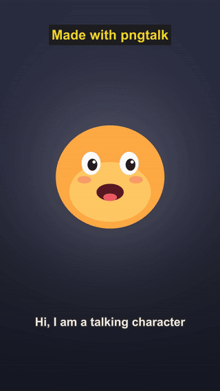
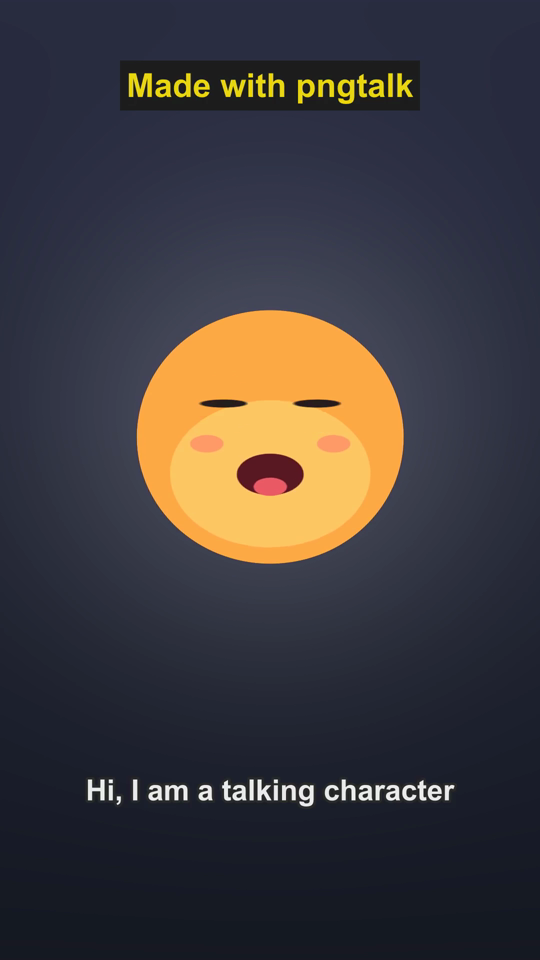
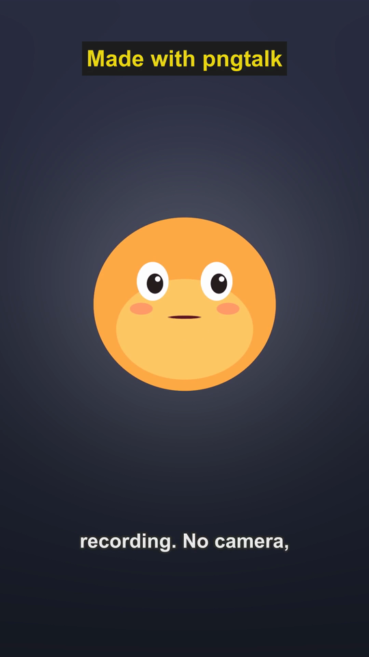
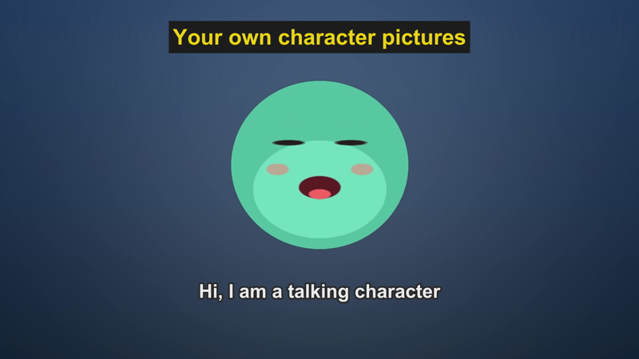

<div align="center">

# pngtalk

**Turn any voice recording into a talking-character video for Shorts, Reels or YouTube, offline, with no credits.**

AI talking-head tools such as digital-human-koubo charge credits per video. PNGTubers have shown for years that a character with a moving mouth is enough to carry a channel. pngtalk does the PNGTuber version as one command: voice in, finished vertical video out.

Works with **Claude Code** and **Codex**.

 



<sub>Real output of <code>python pngtalk.py --demo</code> (4 s of 17 s, scaled down for the GIF). The voice is Windows' built-in speech.</sub>

</div>

## Install in Claude Code / Codex

```bash
/plugin marketplace add Dodai0419/pngtalk
/plugin install pngtalk@pngtalk
```

Codex: `git clone https://github.com/Dodai0419/pngtalk && cp -r pngtalk/skills/* ~/.codex/skills/`

Then ask: *"turn voice.m4a into a vertical Short with captions from script.txt"*.

## Quick start

```bash
pip install numpy          # plus ffmpeg on your PATH
python pngtalk.py --demo
```

```
demo voice: Windows speech
wrote /tmp/pngtalk-demo.mp4: 1080x1920, 16.97 s, 509 frames, built-in mascot
  talking 79% of the time, 8 caption lines, voice mastered to -14 LUFS
```

Your own recording and script:

```bash
python pngtalk.py voice.m4a -o short.mp4 --script @script.txt --title "3 tips for better sleep"
```

## Gallery

| Talking (1080x1920) | Blinking between words | Your own pictures, `--style wide` |
|---|---|---|
|  |  |  |

The third one uses four PNG pictures passed with `--closed`, `--open`, `--closed-blink` and `--open-blink` (here drawn with the built-in mascot in another colour, saved as PNG). Any character art works the same way.

All images come from real runs of the commands in this README.

## The problem

- Talking-head AI services charge per video: digital-human-koubo's own README puts one 27-second ad at 482 Renoise credits, and it needs an account and a network connection for every render.
- A PNGTuber setup (LivLiv Player, Veadotube, OBS) is made for live streams in a browser or a streaming app. Getting a finished video file out of it means screen recording.
- Captions are a separate job, and lining them up with your speech by hand takes longer than the recording.

## The solution

| Idea | Fixes |
|------|-------|
| **Mouth from the voice's loudness** | Quick to open, slower to close, measured against the recording's own quiet floor and loud peak, so a quiet or a loud voice both move the mouth fully |
| **PNGTuber picture set, or the built-in mascot** | Bring 2 to 4 pictures (mouth closed, open, and eyes-closed versions, as LivLiv Player's PNGTuber mode takes them), or use the mascot with no art at all |
| **Captions timed to your speech** | `--script` lines are spread over the time the character is actually talking, skipping the pauses; `--srt` uses your own timing |
| **Packaged like a talking-head video** | Voice cleaned (high-pass, denoise, gentle compression) and mastered to -14 LUFS, title on top, captions in the lower third, 9:16, 1:1 or 16:9 |
| **Offline and free** | numpy and ffmpeg only. No account, no API key, no per-video cost |

## Your own character

```bash
python pngtalk.py voice.wav -o me.mp4 --closed me-closed.png --open me-open.png
python pngtalk.py voice.wav -o me.mp4 --closed c.png --open o.png --closed-blink cb.png --open-blink ob.png
```

| Pictures given | What moves |
|---|---|
| `--closed` only | bounce and breathing with the voice; the picture itself does not change |
| `--closed --open` | mouth opens on the voice, bounce and breathing |
| all four | mouth, blinks every 2.5 to 5.5 s, bounce and breathing |
| none | the built-in mascot: six mouth shapes, blinks, bounce and breathing |

Tips: square-ish PNGs with transparency, the character filling most of the frame, and the open and closed pictures drawn at the same position.

## All options

```
python pngtalk.py VOICE [-o OUT] [--style vertical|square|wide] [--script TEXT|@file] [--srt FILE]
                  [--title TEXT] [--bg #rrggbb] [--closed PNG] [--open PNG] [--closed-blink PNG]
                  [--open-blink PNG] [--seed N] [--json]
python pngtalk.py --demo
```

| Option | Default | What it does |
|---|---|---|
| `VOICE` | | wav, mp3, m4a, or a video with sound |
| `-o` | `<voice>-talk.mp4` | output; must differ from every input |
| `--style` | `vertical` | 1080x1920, 1080x1080 or 1920x1080 |
| `--script` | | what is said, as text or `@file.txt`; captions follow the talking time |
| `--srt` | | captions with their own timing (not together with `--script`) |
| `--title` | | a line at the top for the whole video |
| `--bg` | `#2b2d42` | background colour, with a soft spotlight behind the character |
| `--seed` | 1 | same seed, same blinks |
| `--json` | off | print size, length, talking share and every caption cue |

Exit codes: 0 written, 2 refused or bad input. No partial output is left behind.

## Use it from an agent

```bash
python pngtalk.py voice.wav -o j.mp4 --script @script.txt --json
```

Output for the demo voice (first three cues shown):

```json
{
 "output": "j.mp4",
 "size": "1080x1920",
 "seconds": 16.97,
 "frames": 509,
 "talking_share": 0.79,
 "captions": 8,
 "character": "built-in mascot",
 "cues": [
  [ 0.1, 2.64, "Hi, I am a talking character"],
  [ 2.64, 4.24, "made from one voice"],
  [ 4.24, 7.08, "recording. No camera,"]
 ]
}
```

An agent can read `cues` to check the captions before posting, and `talking_share` to spot a silent or clipped recording.

## How it works

1. ffmpeg decodes the voice to 48 kHz mono. Loudness is measured per video frame (30 fps) and mapped between the 20th and 97th percentile, then smoothed: fast attack, slower release. That is the mouth track.
2. Talking spans are where the mouth is open, with pauses under 0.3 s bridged. Script lines get talking time in proportion to their length.
3. The character's 12 frames (6 mouth shapes x eyes open or closed) are drawn once. Each video frame picks one by mouth level and blink, moves it up with the voice (smoothed) and with a slow breath, and blends it onto a precomputed background in integer math, touching only the character's box.
4. Frames go to ffmpeg over a pipe. ffmpeg burns the captions from an ASS file, cleans and masters the voice, and encodes H.264 + AAC.

## Why this instead of the sources

| | digital-human-koubo | LivLiv Player | pngtalk |
|---|---|---|---|
| Output | a finished talking-head video | a live character in a web page | a finished talking-character video |
| Character | photoreal AI presenter from a photo | 2.5D models, VRM, PNGTuber | PNGTuber pictures or a built-in mascot |
| Cost per video | Renoise credits (482 for a 27 s ad, per its README) | free | free |
| Needs | Renoise account, Remotion, Node, an agent | a browser, WebGL2 | Python, numpy, ffmpeg |
| Works offline | no | yes | yes |
| Captions | ASR and styled templates | none | from your script or SRT |

**Use digital-human-koubo** when you want a realistic human presenter and are fine paying for it. **Use LivLiv Player** for a live character on a stream or a page. **Use pngtalk** when you want a finished video from a voice, now, for free.

## Benchmarks

Windows 11, Python 3.11, numpy 2.4, ffmpeg 9.0, laptop, 3 runs (the machine was busy for some of them, which is why the ranges are wide). Run it yourself with `python bench/bench.py`.

| | digital-human-koubo | pngtalk |
|---|---|---|
| Draw the character | AI generation per video, not measured | 0.6 to 0.8 s for 12 frames |
| Voice to mouth track, 20 s | not applicable | 170 to 290 ms |
| Render 20 s, 1080x1920 with captions | not measured (cloud render) | 28 to 37 s |
| Render 20 s, 1920x1080 with captions | not measured | 25 to 38 s |
| Code | 917 files in the repo (skill, Remotion templates, assets) | 359 lines, one file |
| Dependencies | Renoise MCP, Remotion 4, Node | numpy, ffmpeg |

Neither upstream was run: koubo needs a paid Renoise account and LivLiv Player renders live in a browser with no video export, so their columns say "not measured". The compositing step went from about 41 ms to a few ms per 1080x1920 frame once it blended only the character's box in integer math; the demo dropped from 43 s to 21 to 26 s end to end on this machine.

## Known limits

- The mouth follows loudness, not phonemes: it opens and closes with the voice but does not shape vowels.
- `--script` timing is proportional, not speech recognition. Lines can drift by a second on long recordings; use `--srt` for exact timing.
- One character per video, centred. No scene changes or B-roll.
- The demo voice uses Windows' built-in speech; on other systems the demo makes a synthetic babble instead.

## Inspired by

- [andyhuo520/digital-human-koubo](https://github.com/andyhuo520/digital-human-koubo) (MIT) - the talking-head packaging: voice clean-up, title, lower-third captions, 9:16 delivery. No code taken.
- [livliv-dev/player](https://github.com/livliv-dev/player) (Apache-2.0) - the PNGTuber picture set and a mouth driven by voice loudness, with idle breathing and blinking. No code taken.

## Roadmap

- [ ] Vowel shapes from the voice's spectrum (round vs wide mouth), as LivLiv's `vowel` parameter does.
- [ ] Word-level captions with a local speech-to-text model when one is installed.
- [ ] Two characters taking turns from a two-track recording.

## License

MIT. See [LICENSE](LICENSE) and [NOTICE](NOTICE).
